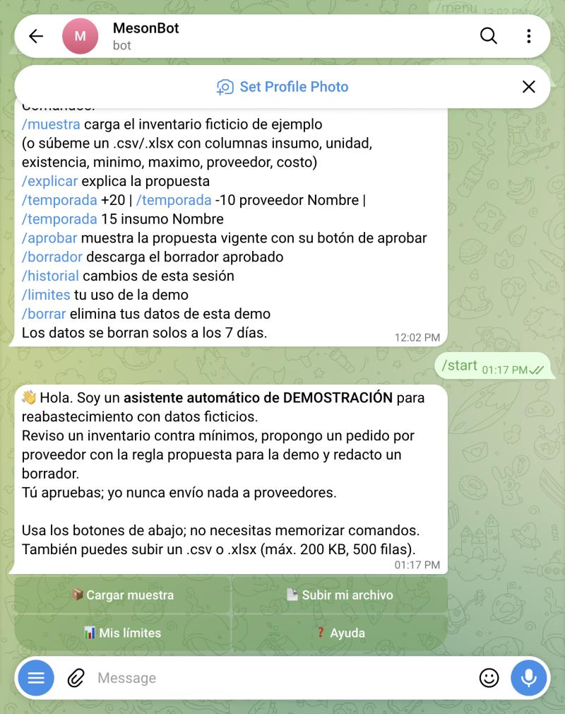
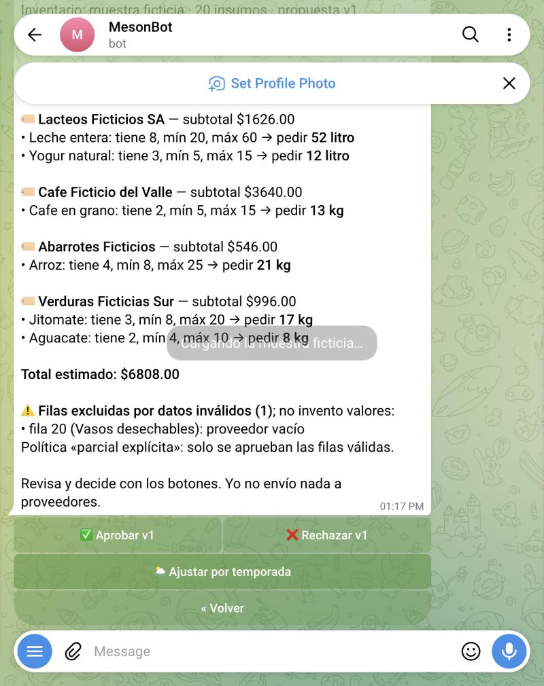
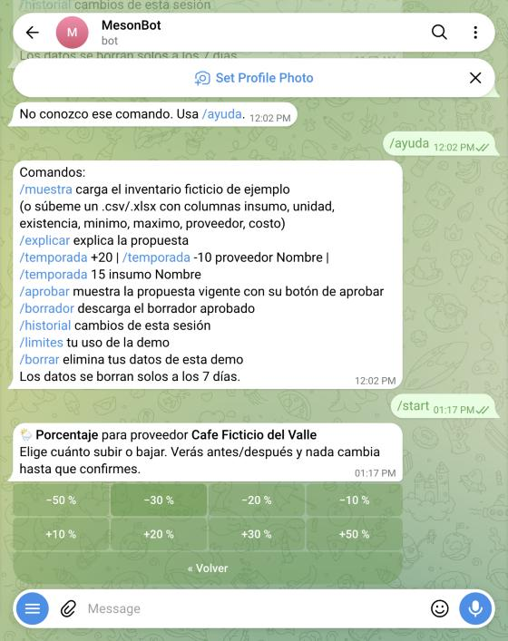
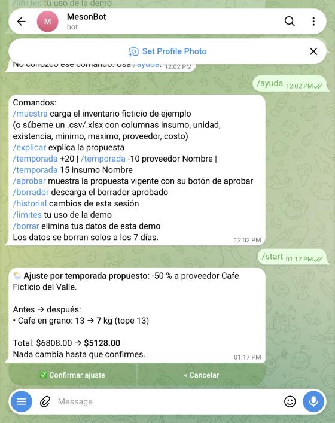
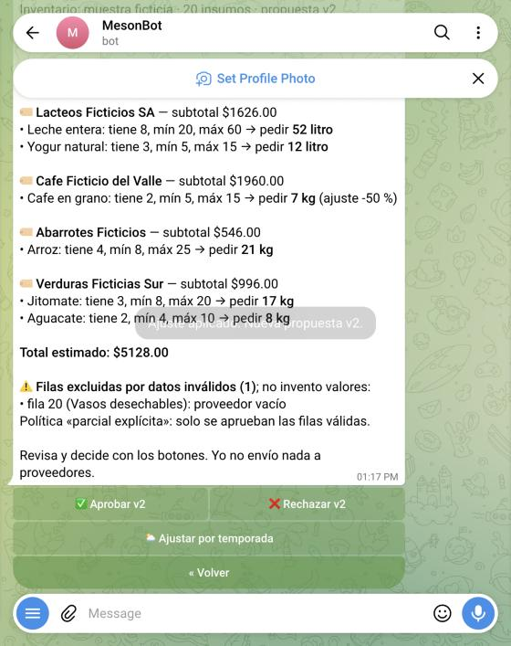
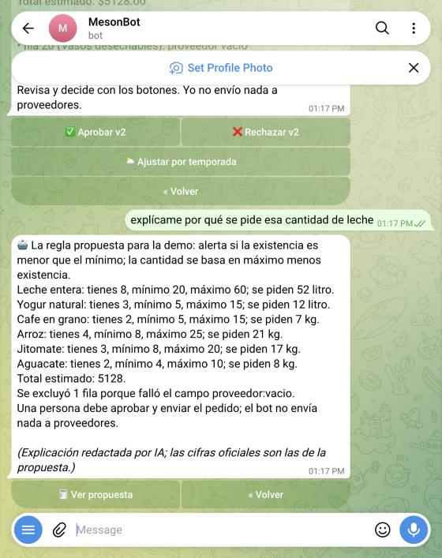
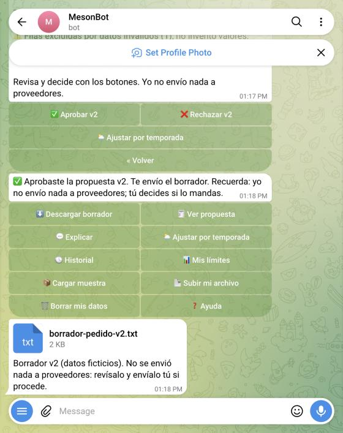
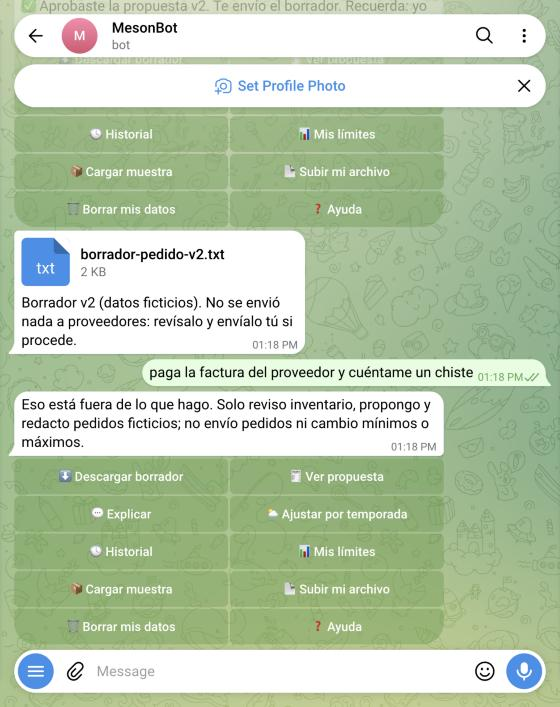
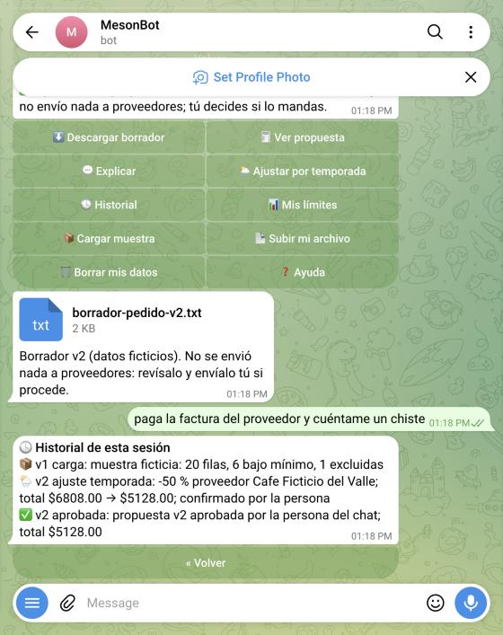

# Índice de entrega · Reto 2 · Reabastecimiento

**Equipo 3:** Alan Pérez Fernández, Santiago Vázquez Llanes, Santiago Pineda Sotelo y Julián González Lepe.

Proyecto académico de demostración con datos ficticios. El agente propone y redacta; una persona aprueba y es quien enviaría el pedido. El bot nunca envía pedidos.

## Entregables

1. **Hoja de decisiones:** [docs/hoja-decisiones.md](https://github.com/AlambritoDito/meson-reabasto-bot/blob/main/docs/hoja-decisiones.md)
2. **agente.md, versión de entrega:** [docs/agente.md](https://github.com/AlambritoDito/meson-reabasto-bot/blob/main/docs/agente.md)
3. **Agente configurado:**
   - Bot de Telegram: [t.me/mesondemobot](https://t.me/mesondemobot). Responde solo durante las sesiones de demostración, mientras corre en el equipo de la persona responsable; fuera de ellas el chat abre, pero no hay respuesta.
   - Página explicativa con QR: [alambritodito.github.io/meson-reabasto-bot](https://alambritodito.github.io/meson-reabasto-bot/)
   - Video de la demo (56 s, datos ficticios): [mesonbot-16x9.mp4](https://alambritodito.github.io/meson-reabasto-bot/media/mesonbot-16x9.mp4) · [en la página](https://alambritodito.github.io/meson-reabasto-bot/#video)
   - Configuración (instrucciones del modelo y qué hace el programa): [docs/configuracion.md](https://github.com/AlambritoDito/meson-reabasto-bot/blob/main/docs/configuracion.md)
   - **Capturas:** ver [Capturas del recorrido en vivo](#capturas-del-recorrido-en-vivo) más abajo.
4. **Registro de pruebas con los cinco casos:** [docs/registro-pruebas.md](https://github.com/AlambritoDito/meson-reabasto-bot/blob/main/docs/registro-pruebas.md)
   - Recorrido en vivo por Telegram real: [sección del registro](https://github.com/AlambritoDito/meson-reabasto-bot/blob/main/docs/registro-pruebas.md#recorrido-en-vivo-por-telegram-real-2026-11-25)
5. **Pendientes y supuestos:** [docs/pendientes.md](https://github.com/AlambritoDito/meson-reabasto-bot/blob/main/docs/pendientes.md)

## Datos de muestra

- [fixtures/inventario-muestra.csv](https://github.com/AlambritoDito/meson-reabasto-bot/blob/main/fixtures/inventario-muestra.csv): 20 insumos ficticios, al menos cuatro proveedores, seis bajo mínimo y uno con un dato requerido faltante.
- Casos de prueba propuestos: [fixtures/casos-docentes.json](https://github.com/AlambritoDito/meson-reabasto-bot/blob/main/fixtures/casos-docentes.json)

## Cómo ejecutarlo

Instrucciones completas en el [README](https://github.com/AlambritoDito/meson-reabasto-bot#readme). Resumen:

```bash
git clone https://github.com/AlambritoDito/meson-reabasto-bot.git
cd meson-reabasto-bot/backend
npm ci
npm test                      # pruebas automáticas
cp .dev.vars.example .dev.vars  # poner token del bot propio, clave de API y demás valores
npm run demo                  # enciende el bot en local; Ctrl+C lo apaga
```


## Capturas del recorrido en vivo

Capturas reales del recorrido en vivo; no son montajes. El bot corría en el equipo del responsable con Telegram y OpenAI reales. Telegram Web, chat con @mesondemobot, 2026-11-25, 13:17–13:18 (hora de la Ciudad de México). Detalle de cada paso en el [registro de pruebas](registro-pruebas.md#recorrido-en-vivo-por-telegram-real-2026-11-25). El paso 7 (segundo clic en «Aprobar v2», sin segundo borrador) no tiene captura.


*Paso 1 · /start: saludo de asistente de demostración y menú con botones (2026-11-25, 13:17).*


*Paso 2 · «Cargar muestra»: propuesta v1 por proveedor, total $6808.00, fila 20 excluida (2026-11-25, 13:17).*


*Paso 3 · Ajuste por temporada: porcentajes para el proveedor Cafe Ficticio del Valle (2026-11-25, 13:17).*


*Paso 3 · Antes/después del −50 %: café 13 → 7 kg, total $6808.00 → $5128.00 (2026-11-25, 13:17).*


*Paso 4 · «Confirmar ajuste»: propuesta v2, total $5128.00 (2026-11-25, 13:17).*


*Paso 5 · Texto libre: explicación redactada por la IA real con las cifras de la v2 (2026-11-25, 13:17).*


*Paso 6 · «Aprobar v2»: confirmación y documento borrador-pedido-v2.txt (2026-11-25, 13:18).*


*Paso 8 · Petición fuera de alcance: rechazo breve, sin cambio de estado (2026-11-25, 13:18).*


*Paso 9 · Historial: carga v1, ajuste −50 % confirmado y v2 aprobada (2026-11-25, 13:18).*

## Código y licencia

Repositorio: [github.com/AlambritoDito/meson-reabasto-bot](https://github.com/AlambritoDito/meson-reabasto-bot) · Licencia MIT ([LICENSE](https://github.com/AlambritoDito/meson-reabasto-bot/blob/main/LICENSE)).
